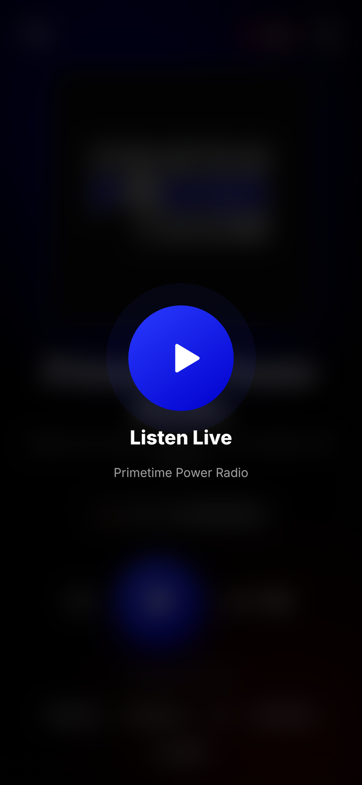
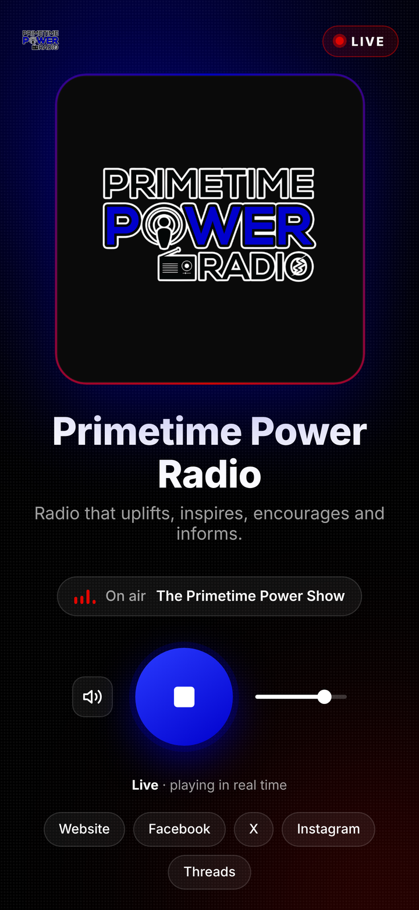
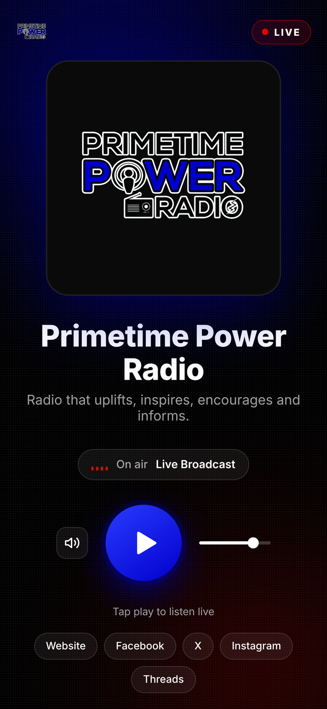

# PPR Live

The live player and Android app for **Primetime Power Radio**:
radio that uplifts, inspires, encourages and informs.

- **Web player:** https://primetimepowershow.com/mediaplayer/pprmediaplayerfull.html
- **Android app:** `com.primetimepowershow.twa`, built from the web player with PWABuilder
- **Privacy policy:** https://primetimepowershow.com/mediaplayer/privacy-policy.html

## Screenshots

| Listen Live | Playing live | Ready to play |
|:---:|:---:|:---:|
|  |  |  |

Store images for product listings are in [`store/`](store/).

## What's in here

| Path | What it is | Where it goes on the server |
|---|---|---|
| `mediaplayer/pprmediaplayerfull.html` | The live player (full screen, always plays in real time) | `primetimepowershow.com/mediaplayer/` |
| `mediaplayer/manifest.webmanifest` | App name, icons and full-screen setting | same folder |
| `mediaplayer/sw.js` | Opens the app instantly; never caches the live stream | same folder |
| `mediaplayer/offline.html` | Screen shown when there's no internet | same folder |
| `mediaplayer/privacy-policy.html` | Privacy policy used by Google Play | same folder |
| `mediaplayer/icon-*.png`, `apple-touch-icon.png` | App icons from the PPR logo | same folder |
| `.well-known/assetlinks.json` | Lets the Android app open without an address bar | `primetimepowershow.com/.well-known/` (site root) |

## How the real-time playback works

- **Stop** closes the connection and throws away buffered audio.
  **Play** always opens a fresh connection at the live point.
- While playing, a watchdog jumps back to live if the stream falls more than 3 seconds behind.
- If buffering lasts more than 6 seconds, the stream errors, or the network drops and returns,
  the player reconnects to live by itself.
- Lock-screen and headset pause act as Stop, so resuming is always live.

Stream: `https://sonicpanel.vmakerhost.com/8033/stream` (settings are at the top of the
`<script>` in `pprmediaplayerfull.html`).

## Updating the player

1. Edit the files in `mediaplayer/` and upload them to the server.
2. If you change icons or other app files, bump `VERSION` in `mediaplayer/sw.js`
   (for example `ppr-player-v3` to `ppr-player-v4`) so phones load the new copies.

Changes to the web player show up in the Android app automatically; no new app release is needed.

## Releasing a new Android version

1. On [PWABuilder](https://www.pwabuilder.com), enter the player URL and choose **Android**.
2. Keep package ID `com.primetimepowershow.twa`, raise the **version code** by 1,
   and under signing choose **Use mine** with the PPR Live keystore.
3. Upload the `.aab` to Play Console; attach the `.apk` to a GitHub Release for direct installs.

> **The signing keystore is not in this repo, on purpose.** Keep it backed up privately.
> Every update must be signed with the same key.

## Address-bar fix (assetlinks.json)

`.well-known/assetlinks.json` lists the fingerprint of the upload key. Once the app is on
Google Play, also add the **App signing key** SHA-256 fingerprint from
Play Console > App integrity to the `sha256_cert_fingerprints` list.
